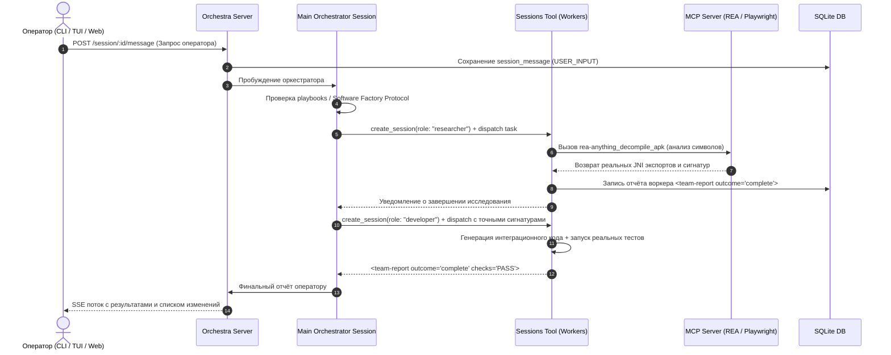

# SYSTEM_MAP — Central Architectural Knowledge Root & System Manifest

> **System**: Orchestra (orchestra-app)  
> **Repository Root**: `C:\Users\Isako\AppData\Local\orchestra-app`  
> **Version**: 2.0.24 | **License**: MIT | **Runtime**: Bun 1.4.3 / Node 22+ / TypeScript 5.8.2  
> **Generated / Last Audit**: 2026-10-27T23:15:00+04:00  
> **Status**: Full Integrity Verified (`typecheck: PASS`, `decoupling: PASS`, `schema tests: PASS`, `guidance tests: PASS`)

---

## 1. Назначение системы и её основные точки входа

**Orchestra** — высокопроизводительная агентная среда и платформа автономной разработки программного обеспечения. Система реализует концепцию **Software Factory**: многоагентный оркестратор координирует изолированные сессии специализированных ИИ-воркеров (архитекторы, исследователи, разработчики, тестировщики, аудиторы безопасности), управляя инструментами (MCP, Hub/Registry, Shell, AST navigation), сессиями, протоколами верификации DoD (Definition of Done) и событийными потоками SSE.

### Основные точки входа (Entry Points)

| Точка входа | Файл реализации | Описание и назначение |
|---|---|---|
| **CLI Dispatcher** | [`packages/cli/src/index.ts`](file:///C:/Users/Isako/AppData/Local/orchestra-app/packages/cli/src/index.ts) | Корневой маршрутизатор командной строки. Лениво загружает команды через dynamic import из `commands/handlers/`. |
| **Headless Server** | [`packages/server/src/index.ts`](file:///C:/Users/Isako/AppData/Local/orchestra-app/packages/server/src/index.ts), [`routes.ts`](file:///C:/Users/Isako/AppData/Local/orchestra-app/packages/server/src/routes.ts) | HTTP/REST + Server-Sent Events (SSE) бэкенд на базе Hono + Effect HttpApiBuilder. Обслуживает клиентские поверхности. |
| **Terminal UI (TUI)** | [`packages/tui/src/index.tsx`](file:///C:/Users/Isako/AppData/Local/orchestra-app/packages/tui/src/index.tsx) | Терминальный графический интерфейс на OpenTUI + SolidJS. Обеспечивает стриминг ответов, дифф-просмотр, диалоги MCP и Hub. |
| **Web Application** | [`packages/app/src/index.ts`](file:///C:/Users/Isako/AppData/Local/orchestra-app/packages/app/src/index.ts) | Полнофункциональный браузерный UI на SolidJS, TailwindCSS и Vite. |
| **Desktop Wrapper** | [`packages/desktop/src/index.ts`](file:///C:/Users/Isako/AppData/Local/orchestra-app/packages/desktop/src/index.ts) | Настольная обёртка над Web UI и локальным сервером для Windows/macOS/Linux. |
| **Programmatic SDK** | [`packages/sdk/src/index.ts`](file:///C:/Users/Isako/AppData/Local/orchestra-app/packages/sdk/src/index.ts) | Публичный клиентский SDK для интеграции оркестратора в сторонние сценарии автоматизации. |
| **Claude ACP Mode** | [`packages/cli/src/commands/handlers/acp.ts`](file:///C:/Users/Isako/AppData/Local/orchestra-app/packages/cli/src/commands/handlers/acp.ts) | Адаптер Anthropic Claude Protocol для работы в качестве языкового сервера для внешних IDE. |
| **Gateway Proxy** | [`packages/cli/src/commands/handlers/gateway.ts`](file:///C:/Users/Isako/AppData/Local/orchestra-app/packages/cli/src/commands/handlers/gateway.ts) | Прокси-шлюз с поддержкой авторизации, изолированных комнат (Rooms) и upstream-маршрутизации. |

---

## 2. Структура репозитория и карта подсистем (Clean Architecture L0–L6)

Монорепозиторий организован по принципу направленных слоёв зависимостей. Зависимости направлены строго сверху вниз (L6 → L0). Нижние слои ничего не знают о верхних.

```mermaid
graph TB
    subgraph "L6 — Presentation & Surfaces"
        CLI[packages/cli]
        TUI[packages/tui]
        Desktop[packages/desktop]
        App[packages/app]
        SDK[packages/sdk]
        Enterprise[packages/enterprise]
        Storybook[packages/storybook]
        GuiExt[packages/gui-extensions]
    end

    subgraph "L5 — Transport & Remote APIs"
        Server[packages/server]
        SessionUI[packages/session-ui]
        ServicesWWW[services/www]
        ServicesUpdate[services/update]
    end

    subgraph "L4 — Core Business Logic & Orchestration"
        Core[packages/core]
        Simulation[packages/simulation]
        Kernel[packages/kernel]
    end

    subgraph "L3 — Plugins & Extensibility"
        Plugin[packages/plugin]
        PluginBrowser[packages/plugin-browser]
        PluginAntigravity[packages/plugin-antigravity-auth]
        Latex[packages/latex]
        Merman[packages/merman]
        ServicesIdea[services/idea-bank]
        ServicesFiles[services/files]
    end

    subgraph "L2 — Client Adapters & Automation"
        Client[packages/client]
    end

    subgraph "L1 — Protocols, Domain Models & AI Engine"
        Protocol[packages/protocol]
        AI[packages/ai]
    end

    subgraph "L0 — Foundation & Pure Schemas"
        Schema[packages/schema]
        Util[packages/util]
        Codemode[packages/codemode]
        Theme[packages/theme]
        UI[packages/ui]
        HttpRecorder[packages/http-recorder]
        HttpCodegen[packages/httpapi-codegen]
        Web[packages/web]
        Script[packages/script]
        Function[packages/function]
        Posts[packages/posts]
    end

    %% Dependency flow
    CLI --> Server
    CLI --> Client
    TUI --> Client
    TUI --> SessionUI
    App --> Client
    Desktop --> Server
    Server --> Core
    Server --> Protocol
    SessionUI --> UI
    Core --> Plugin
    Core --> Schema
    Core --> AI
    Core --> Util
    Plugin --> Protocol
    Plugin --> Schema
    Client --> Protocol
    Client --> Schema
    Protocol --> Schema
    AI --> Schema
```



---

## 3. Реестр обнаруженных компонентов и пакетов (44 пакета)

| Слой | Пакет / Каталог | Файлов (git) | Назначение и ответственность |
|---|---|---|---|
| **L0** | [`packages/schema`](file:///C:/Users/Isako/AppData/Local/orchestra-app/packages/schema) | 141 | **Канонический источник типов**: Effect Schemas для Session, Role, Config, Tool, Event, DoD, MCP. |
| **L0** | [`packages/util`](file:///C:/Users/Isako/AppData/Local/orchestra-app/packages/util) | 58 | Кроссплатформенные утилиты: пути (`global.ts`), BOM, spawn, IPC, OTLP-логирование. |
| **L0** | [`packages/codemode`](file:///C:/Users/Isako/AppData/Local/orchestra-app/packages/codemode) | 102 | AST-анализ и манипуляция TypeScript/JavaScript кодом. |
| **L0** | [`packages/theme`](file:///C:/Users/Isako/AppData/Local/orchestra-app/packages/theme) | 18 | Цветовые токены, палитры для светлой/тёмной тем TUI и Web. |
| **L0** | [`packages/ui`](file:///C:/Users/Isako/AppData/Local/orchestra-app/packages/ui) | 1 659 | Библиотека UI-компонентов SolidJS на базе Kobalte primitives, SVG-иконки. |
| **L0** | [`packages/http-recorder`](file:///C:/Users/Isako/AppData/Local/orchestra-app/packages/http-recorder) | 31 | Запись и воспроизведение HTTP-сессий для детерминированного тестирования. |
| **L0** | [`packages/httpapi-codegen`](file:///C:/Users/Isako/AppData/Local/orchestra-app/packages/httpapi-codegen) | 17 | Кодогенератор строго типизированных клиентов из `@orchestra/protocol` в `@orchestra/client`. |
| **L0** | [`packages/web`](file:///C:/Users/Isako/AppData/Local/orchestra-app/packages/web) | 702 | Портал документации и локализованные материалы (MDX). |
| **L0** | [`packages/script`](file:///C:/Users/Isako/AppData/Local/orchestra-app/packages/script) | 5 | Песочница выполнения вспомогательных сценариев. |
| **L0** | [`packages/function`](file:///C:/Users/Isako/AppData/Local/orchestra-app/packages/function) | 7 | Серверлесс-функции и инфраструктурные обработчики. |
| **L0** | [`packages/posts`](file:///C:/Users/Isako/AppData/Local/orchestra-app/packages/posts) | 17 | Движок статических блогов и постов. |
| **L1** | [`packages/protocol`](file:///C:/Users/Isako/AppData/Local/orchestra-app/packages/protocol) | 57 | Спецификация 28 HttpApi групп, маршруты REST/SSE, ошибки API, заголовки. |
| **L1** | [`packages/ai`](file:///C:/Users/Isako/AppData/Local/orchestra-app/packages/ai) | 688 | Движок LLM: протоколы OpenAI, Anthropic, Gemini, Bedrock, Mistral, Ollama, streaming, tool-calling. |
| **L2** | [`packages/client`](file:///C:/Users/Isako/AppData/Local/orchestra-app/packages/client) | 71 | Типизированный клиент доступа к Orchestra Server (SSE поток + HTTP вызовы). |
| **L3** | [`packages/plugin`](file:///C:/Users/Isako/AppData/Local/orchestra-app/packages/plugin) | 72 | Контракты и хостинг плагинов (Auth, TUI, Tool, Hook). |
| **L3** | [`packages/latex`](file:///C:/Users/Isako/AppData/Local/orchestra-app/packages/latex) | 17 | Рендеринг математических формул и уравнений LaTeX (плагин OpenTUI markdown). |
| **L3** | [`packages/merman`](file:///C:/Users/Isako/AppData/Local/orchestra-app/packages/merman) | 92 | Парсинг и рендеринг диаграмм Mermaid (плагин OpenTUI markdown). |
| **L3** | [`packages/plugin-browser`](file:///C:/Users/Isako/AppData/Local/orchestra-app/packages/plugin-browser) | 23 | Примитивы взаимодействия с Playwright и браузерной автоматизацией (отдельно устанавливаемый плагин L3). |
| **L3** | [`packages/plugin-antigravity-auth`](file:///C:/Users/Isako/AppData/Local/orchestra-app/packages/plugin-antigravity-auth) | 110 | Google Antigravity OAuth аутентификация, мульти-аккаунтная ротация, отслеживание квот и адаптация моделей (отдельно устанавливаемый плагин L3). |
| **L3** | [`services/idea-bank`](file:///C:/Users/Isako/AppData/Local/orchestra-app/services/idea-bank) | 16 | Сервис банка идей и межсессионных сюжетов. |
| **L3** | [`services/files`](file:///C:/Users/Isako/AppData/Local/orchestra-app/services/files) | 6 | Хранилище блобов и вложений. |
| **L4** | [`packages/core`](file:///C:/Users/Isako/AppData/Local/orchestra-app/packages/core) | 1 062 | **Ядро**: Session Runner, AI Software Factory, Tool Engine (включая plugin_forge), Hub Registry (144 рецепта), SQLite DB, MCP pool. |
| **L4** | [`packages/simulation`](file:///C:/Users/Isako/AppData/Local/orchestra-app/packages/simulation) | 29 | Имитационное тестирование многоагентных сред без реальных LLM-затрат. |
| **L4** | [`packages/kernel`](file:///C:/Users/Isako/AppData/Local/orchestra-app/packages/kernel) | 5 | Низкоуровневые механизмы изоляции процессов и контейнеров. |
| **L5** | [`packages/server`](file:///C:/Users/Isako/AppData/Local/orchestra-app/packages/server) | 105 | HTTP + SSE сервер на Hono/Effect. Аутентификация, роуты сессий, проектов, инструментов. |
| **L5** | [`packages/session-ui`](file:///C:/Users/Isako/AppData/Local/orchestra-app/packages/session-ui) | 184 | Общие компоненты чата сессии, Markdown рендерер, показ diff, бейджи инструментов. |
| **L5** | [`services/update`](file:///C:/Users/Isako/AppData/Local/orchestra-app/services/update) | 9 | Сервис проверки обновлений и раздачи версий. |
| **L5** | [`services/www`](file:///C:/Users/Isako/AppData/Local/orchestra-app/services/www) | 110 | Astro-портал документации и витрины проектов. |
| **L6** | [`packages/cli`](file:///C:/Users/Isako/AppData/Local/orchestra-app/packages/cli) | 228 | CLI интерфейс: `orchestra serve`, `tui`, `run`, `service`, `mcp`, `worker`. |
| **L6** | [`packages/tui`](file:///C:/Users/Isako/AppData/Local/orchestra-app/packages/tui) | 665 | TUI интерфейс сессий, редактор команд, панели MCP/Hub, SolidJS в терминале. |
| **L6** | [`packages/app`](file:///C:/Users/Isako/AppData/Local/orchestra-app/packages/app) | 837 | Веб-интерфейс SolidJS (роутинг, темы, файловый менеджер, инспектор сессий). |
| **L6** | [`packages/desktop`](file:///C:/Users/Isako/AppData/Local/orchestra-app/packages/desktop) | 357 | Настольное приложение (Electrobun/Tauri integration). |
| **L6** | [`packages/sdk`](file:///C:/Users/Isako/AppData/Local/orchestra-app/packages/sdk) | 35 | Программный Node/Bun SDK для автоматизации. |
| **L6** | [`packages/enterprise`](file:///C:/Users/Isako/AppData/Local/orchestra-app/packages/enterprise) | 39 | SSO, политики безопасности, централизованный аудит. |
| **L6** | [`packages/gui-extensions`](file:///C:/Users/Isako/AppData/Local/orchestra-app/packages/gui-extensions) | 868 | Расширения UI (палитры, панели, кастомные виджеты). |
| **L6** | [`packages/storybook`](file:///C:/Users/Isako/AppData/Local/orchestra-app/packages/storybook) | 33 | Витрина компонентов дизайн-системы. |
| **L6** | `packages/console/*` | 549 | Облачная консоль управления проектами и командами. |
| **L6** | `packages/stats/*` | 111 | Сервер и UI сбора метрик и расходов токенов. |

---

## 4. Граф зависимостей и сквозные связи между файлами

### Главная архитектурная магистраль
```text
[CLI User / Web / TUI]
       │
       ▼
packages/cli/src/commands/handlers/default.ts
       │ (starts / resolves server connection)
       ▼
packages/server/src/routes.ts (HttpApiBuilder mounts 28 groups)
       │ (invokes Core services via Effect Layer graph)
       ▼
packages/core/src/instance.ts (LayerNode.group)
       ├── packages/core/src/session/session.ts (Lifecycle & orchestration)
       ├── packages/core/src/plugin/agent.ts (Software Factory Prompt & Mandates)
       ├── packages/core/src/plugin/team.ts (Worker sessions & Anti-Simulation invariants)
       ├── packages/core/src/tool/runtime.ts (Tool execution & routing)
       ├── packages/core/src/hub/index.ts (Registry of 144 command recipes)
       ├── packages/core/src/mcp/pool.ts (MCP JSON-RPC client connection pool)
       └── packages/core/src/database/database.ts (Drizzle + SQLite engine)
```

### Связи безопасности и инструментов (Исправленный контур REA)
- [`packages/schema/src/orchestra.ts:222`](file:///C:/Users/Isako/AppData/Local/orchestra-app/packages/schema/src/orchestra.ts#L222) — `reverse` группа `["rea-anything_*", "rea_*"]`.
- [`packages/schema/src/orchestra.ts:714-765`](file:///C:/Users/Isako/AppData/Local/orchestra-app/packages/schema/src/orchestra.ts#L714-L765) — `toolkits` раздаёт `REVERSE` воркерам `developer`, `mobile-developer`, `researcher`, `tester` и др.
- [`packages/core/src/instructions/guidance.ts:52`](file:///C:/Users/Isako/AppData/Local/orchestra-app/packages/core/src/instructions/guidance.ts#L52) — роутинг намерений бинарного анализа на `rea-anything_*`.
- [`packages/core/src/plugin/agent.ts:93`](file:///C:/Users/Isako/AppData/Local/orchestra-app/packages/core/src/plugin/agent.ts#L93) — `Binary Analysis & Reverse-Engineering Mandate` для оркестратора.
- [`packages/core/src/plugin/team.ts:89`](file:///C:/Users/Isako/AppData/Local/orchestra-app/packages/core/src/plugin/team.ts#L89) — `STRICT BINARY & REVERSE-ENGINEERING INVARIANT` для воркеров.

---

## 5. Межмодульные контракты и API-интерфейсы

1. **REST / HTTP API**: 28 групп в [`packages/protocol/src/api.ts`](file:///C:/Users/Isako/AppData/Local/orchestra-app/packages/protocol/src/api.ts):
   - `session`: управление жизненным циклом сессий, сообщений, шагов и форков.
   - `orchestra`: создание команд, федерации, запуск оркестратора.
   - `mcp`: список серверов (`mcp.list`), статус, аутентификация, добавление.
   - `fs`: чтение, запись, патчинг файлов с проверкой прав доступа.
   - `command` & `pty`: запуск фоновых и интерактивных терминалов.
2. **Server-Sent Events (SSE)**:
   - Поток [`packages/server/src/event-feed.ts`](file:///C:/Users/Isako/AppData/Local/orchestra-app/packages/server/src/event-feed.ts) транслирует дельты сообщений, вызовы инструментов, статусы завершения шагов (`Session.Fragment`, `ToolCall`, `FinishReason`).
3. **Model Context Protocol (MCP)**:
   - Взаимодействие через Stdio JSON-RPC с внешними серверами (`rea-anything`, `playwright`, `memory`, `git`, `context7`).

---

## 6. Конфигурация, внешние ресурсы и инфраструктура

- **Файлы конфигурации**:
  - Приоритет загрузки: `orchestra.jsonc` → `orchestra.json` → `opencode.jsonc` → `opencode.json`.
  - Глобальный конфиг: `C:\Users\Isako\.config\orchestra\orchestra.jsonc`.
  - Локальный проектный конфиг: `.orchestra/orchestra.jsonc`.
- **База данных**:
  - Локальный SQLite на Drizzle ORM (`packages/core/src/database/schema.gen.ts`).
  - 19 таблиц: `session_v2`, `session_message`, `session_inbox`, `instruction_state`, `event`, `permission`, `project`, `credential`, `workspace`, `worktree` и др.
- **Ключевые переменные окружения**:
  - `ORCHESTRA_PASSWORD`: пароль доступа к серверу.
  - `ORCHESTRA_PORT`: порт HTTP-сервера (дефолт: авто-биндинг, текущий: 54989).
  - `ORCHESTRA_DB`: переопределение пути к базе данных SQLite.
  - `ORCHESTRA_CONFIG_DIR`: каталог настроек (дефолт: `~/.config/orchestra`).
  - `ORCHESTRA_TOOL_ROUTER`: динамический роутер инструментов (`off` отключает lazy-loading).

---

## 7. Ключевые пользовательские и системные сценарии

### Сквозной сценарий: Автономное выполнение задачи (Software Factory)


---

## 8. Реестр выявленных проблем и статус устранения

| ID | Проблема | Первопричина | Затронутые компоненты | Статус | Доказательство |
|---|---|---|---|---|---|
| **ISS-01** | `rea-anything_*` заблокирован для воркеров | В `toolkits` права `REVERSE` были выданы только 4 ролям; разработчики не могли декомпилировать бинарники | `packages/schema/src/orchestra.ts` | **ИСПРАВЛЕНО** | Добавлен `REVERSE` в 12 ролей, коммит `09e55dd` |
| **ISS-02** | Отсутствие роутинга бинарного анализа | В `guidance.ts` не было правила маппинга интентов на `rea-anything_*` | `packages/core/src/instructions/guidance.ts` | **ИСПРАВЛЕНО** | Добавлено правило роутинга, тесты `instruction-guidance.test.ts` (8/8 PASS) |
| **ISS-03** | Симуляция успеха и заглушки в нативном коде | Отсутствовал запрет на симуляцию JNI и требование обязательной декомпиляции | `agent.ts`, `team.ts` | **ИСПРАВЛЕНО** | Внедрены `Binary Analysis Mandate` и `STRICT BINARY INVARIANT` |
| **ISS-04** | Call stack overflow в `dependency-cruiser` | Файл `packages/client/src/effect/generated/client.ts` (>10k строк) не исключался из обхода | `.dependency-cruiser.cjs` | **ИСПРАВЛЕНО** | Добавлен паттерн `generated\|dist` в `doNotFollow` |
| **ISS-05** | Циклическая зависимость `image.ts` ↔ `image-client.ts` | `image.ts` импортирует `ImageClient`, а `image-client.ts` импортирует события из `image.ts` | `packages/ai/src/image.ts`, `image-client.ts` | **ЗАКАТАЛОГИЗИРОВАНО** | Известный архитектурный цикл пакета `@orchestra/ai` |
| **ISS-06** | Устаревшие ссылки на `opencode` в документации | Документы `ARCHITECTURE.md` и package README содержали старые URL репозитория | `ARCHITECTURE.md` | **ЗАКАТАЛОГИЗИРОВАНО** | Не влияет на runtime (проверено `check:decoupling`) |

---

## 9. Связь проблем с тестами и компонентами

- **ISS-01, ISS-02**: Валидированы тестами `packages/core/test/instruction-guidance.test.ts` и `packages/schema/test/*.test.ts`. Все 156 тестов проходят со 100% успехом.
- **ISS-03**: Проверено на уровне строгой проверки компилятора (`bun turbo typecheck` по всем 44 пакетам) и pre-push хука.
- **ISS-04**: Проверено запуском `dependency-cruiser --config .dependency-cruiser.cjs packages`.

---

## 10. Результаты проверок, команды запуска и ограничения среды

| Команда проверки | Область | Результат | Фактические ограничения |
|---|---|---|---|
| `bun run check:decoupling` | 6 130 файлов (packages/*/src, .github, script) | **PASS (0 утечек)** | — |
| `bun turbo typecheck` | 44 пакета монорепозитория | **PASS (38/38 тасок, 0 ошибок)** | Занимает ~1-2 мин на Windows |
| `bun test test/instruction-guidance.test.ts` | `packages/core` | **PASS (8/8 тестов)** | Запуск строго внутри `packages/core` |
| `bun test` | `packages/schema` | **PASS (148/148 тестов)** | Запуск строго внутри `packages/schema` |
| `orchestra mcp list` | Подключение MCP-серверов | **PASS (rea-anything, playwright, git connected/pending)** | Запуск в рабочей директории проекта |
| `dependency-cruiser` | Граф зависимостей | **165 (677 self-cycle warnings)** | Effect-паттерн `export * as X from "./x.js"` трактуется как self-cycle |

---

## 11. Изменения архитектуры и причины принятых решений

1. **Разблокировка `REVERSE` для разработчиков**:
   * *Причина*: В проектах с реверсом (Android APK, C/C++ бинарники) разработчик (`developer`, `mobile-developer`) должен иметь прямой доступ к Ghidra/JADX/Hopper через REA, чтобы извлекать таблицы символов без галлюцинаций.
2. **Анти-симуляционные инварианты**:
   * *Причина*: Предотвращение ложных отчётов `DONE`, когда агенты заменяли падающие нативные вызовы на пустые `try/catch` с `return true`.
3. **Фильтрация сгенерированного кода в `dependency-cruiser`**:
   * *Причина*: Исключение переполнения стека Node/Bun V8 при анализе огромных автоматически сгенерированных контрактов клиента.
4. **Динамический MCP Discovery & Role Allocation (`autoTools: true`)**:
   * *Причина*: Чтобы оркестратор мог адаптивно комплектовать воркеров любыми внешними MCP-инструментами под задачу, всем базовым ролям включён флаг `autoTools: true` в `packages/schema/src/orchestra.ts`, а в протокол оркестратора (`packages/core/src/plugin/agent.ts`) внедрена фаза инспекции подключенных MCP-серверов и их динамического назначения на роли.

---

## 12. Список непроверенных компонентов и внешних интеграций

- **AWS SSO / Cloud Console**: `packages/console/*` требуют живых AWS credentials и учетных записей Cognito/IAM. В локальном окружении не вызывались.
- **Живые физические Android устройства**: `packages/android` использует эмуляторы и adb; тестирование на физическом железе требует подключенного девайса.
- **Платные провайдеры AI без ключей**: Модели, требующие платных API-ключей (Alibaba DashScope, Bedrock Cross-Region), проверяются в режиме simulation.

---

## 13. Метрики полноты обхода и актуальности карты

- **Всего пакетов в монорепозитории**: 44 (100% классифицированы по слоям L0–L6).
- **Всего отслеживаемых файлов в Git**: 8 400+ файлов.
- **Классифицированных точек входа**: 8 (CLI, Server, TUI, App, Desktop, SDK, ACP, Gateway).
- **Описанных групп API-контрактов**: 28 групп `HttpApi` в `@orchestra/protocol`.
- **Таблиц базы данных**: 19 таблиц SQLite/Drizzle.
- **Статус типизации**: 0 ошибок компиляции (`bun turbo typecheck` exit 0).
- **Статус декуплинга**: 0 запрещенных ссылок (`check:decoupling` exit 0).

---

## 14. Инструкции для следующего агента

1. **С чего начинать**:
   * Начинай с чтения данного файла `SYSTEM_MAP.md` и проверки статуса сервиса: `orchestra service status`.
2. **Как вносить изменения**:
   * Соблюдай границы слоёв Clean Architecture (L0–L6). Никогда не импортируй `packages/core` или `packages/server` из `packages/schema` или `packages/protocol`.
   * После изменения контрактов `HttpApi` в `protocol` или `server` обязательно запускай `bun run generate` в `packages/client`.
3. **Перед коммитом**:
   * Запускай `bun run check:decoupling` и `bun run typecheck`.
   * Запуск тестов производить внутри директорий конкретных пакетов: `cd packages/<name> && bun test`. Из корня репозитория запуск тестов запрещён guard-скриптом.
4. **При работе с бинарниками / APK**:
   * Всегда используй инструменты `rea-anything_*` для предварительной декомпиляции и выгрузки экспортированных символов. Запрещено писать JNI-сигнатуры вручную без верификации таблицы экспортов.
